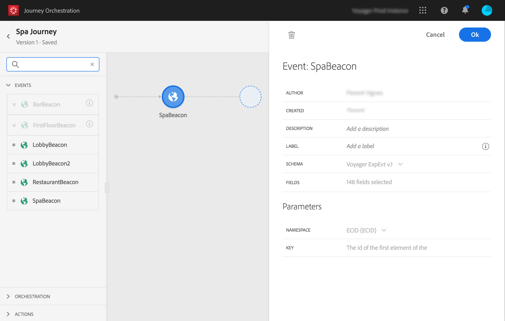

# Eventi generali {#section_ofg_jss_dgb}

>[!CAUTION]
>
>**Stai cercando Adobe Journey Optimizer**? Fai clic [qui](https://experienceleague.adobe.com/it/docs/journey-optimizer/using/ajo-home){target="_blank"} per la documentazione di Journey Optimizer.
>
>
>_Questa documentazione fa riferimento ai precedenti materiali su Journey Orchestration, che è stato sostituito da Journey Optimizer. In caso di domande sull’accesso a Journey Orchestration o Journey Optimizer, contatta il team del tuo account._

Per questo tipo di evento, puoi aggiungere solo un’etichetta e una descrizione. Impossibile modificare il resto della configurazione. È stata eseguita dall’utente tecnico. Consulta [questa pagina](../event/about-events.md).

